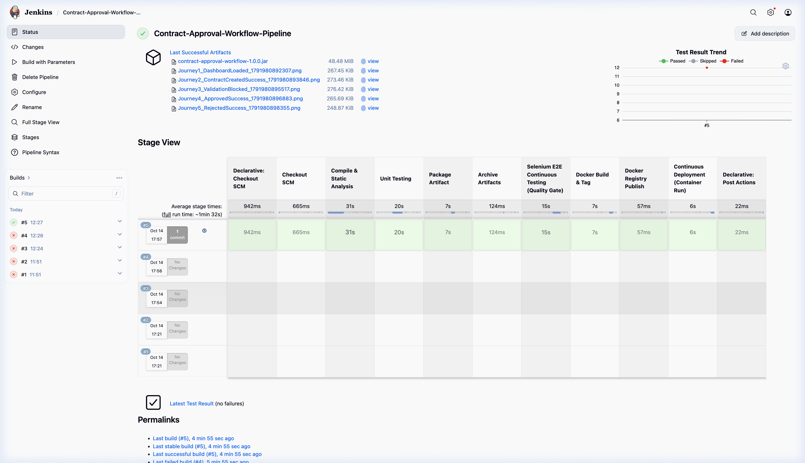

# Dockerized Contract Approval Workflow (CaseDocker / ContractFlow)

> **Academic DevOps Capstone Project**  
> **Student Name:** Shruti Gupta  
> **Roll No.:** 23102C0051  
> **Repository:** [https://github.com/sarahcheulkar/contract-approval-workflow](https://github.com/sarahcheulkar/contract-approval-workflow)  

---

## 📌 Executive Summary & Problem Definition

In modern organizations, negotiating, validating, and approving contracts across legal, operations, and finance departments via manual email threads results in:
* **Severe Approval Delays**: Average contract cycle time exceeds 30+ days.
* **Audit & Compliance Gaps**: Lack of immutable reviewer remarks and timestamped state transitions.
* **Operational Blindspots**: No centralized dashboard to track contract expiration, renewals, and pending bottlenecks.

**ContractFlow** is an enterprise-grade automated approval workflow portal featuring an **8-Stage Contract Lifecycle** (`Initiation` $\rightarrow$ `Review` $\rightarrow$ `Approval` $\rightarrow$ `Execution` $\rightarrow$ `Analytics` $\rightarrow$ `Renewal` $\rightarrow$ `Expiry` $\rightarrow$ `Archived`) backed by a fully automated DevOps pipeline.

---

## 🏗 System Architecture & Technology Stack

```
   ┌─────────────────────────────────────────────────────────┐
   │            Web UI (HTML5 / Modern CSS / Vanilla JS)      │
   │      CaseDocker 8-Stage Stepper • Donut & Wave Charts   │
   └────────────────────────────┬────────────────────────────┘
                                │ REST APIs (/api/contracts)
                                ▼
   ┌─────────────────────────────────────────────────────────┐
   │             Spring Boot 3.2.4 REST Application           │
   │  Controllers • Validation • Business Logic • Actuator   │
   └────────────────────────────┬────────────────────────────┘
                                │ Spring Data JPA
                                ▼
   ┌─────────────────────────────────────────────────────────┐
   │            In-Memory H2 / Embedded Database             │
   └─────────────────────────────────────────────────────────┘
```

* **Backend**: Java 17, Spring Boot 3.2.4, Spring Data JPA, Hibernate, Spring Boot Actuator
* **Frontend**: HTML5, Modern CSS3 with Glassmorphism & Keyframe Animations, Reactive Vanilla JavaScript
* **Build Automation**: Apache Maven 3.9 (`pom.xml`)
* **Continuous Integration**: Jenkins Declarative Pipeline (`Jenkinsfile`)
* **Automated Quality Gate**: Selenium WebDriver with automated screenshot capture
* **Containerization**: Docker (Multi-stage build) & Docker Compose
* **Configuration Management**: Ansible (`inventory.ini`, `playbook.yml`, `rollback.yml`)

---

## 📋 14 Project Deliverables Mapping

| Milestone | Deliverable Name | Repository Asset / Evidence |
| :---: | :--- | :--- |
| **1** | Problem Definition & Scope | [README.md Section 1](#-executive-summary--problem-definition) & `project_roadmap.md` |
| **2** | Agile Planning & DevOps Workflow | `project_roadmap.md` & Sprint Backlog |
| **3** | Architecture & Tech Setup | `pom.xml`, `application.properties`, Spring Boot source code |
| **4** | Git Repository Initialization | `.gitignore`, `BRANCHING_POLICY.md`, initial Git commits |
| **5** | Feature Development & Branching | Branch `feature/contract-submission`, PR and merge history |
| **6** | MVP Completion & Conflict Resolution | Branch `feature/approval-decision`, conflict resolution log, Git tag `v1.0.0` |
| **7** | Jenkins CI Build Job | Maven build step, archive artifact `contract-approval-workflow-1.0.0.jar` |
| **8** | Pipeline as Code (`Jenkinsfile`) | `Jenkinsfile` with parameterized environments (`QA`, `STAGING`, `PROD`) |
| **9** | Selenium Test Design & Execution | `src/test/java/com/contractflow/selenium/ContractWorkflowSeleniumTest.java` |
| **10** | Continuous Testing & Quality Gate | Jenkins test stage publishing JUnit reports and aborting on defect |
| **11** | Docker Image & Container Lifecycle | Multi-stage `Dockerfile` and `docker-compose.yml` |
| **12** | Jenkins-Docker CD Pipeline | `Jenkinsfile` Docker build, tag, and automated container deployment |
| **13** | Configuration Management (Ansible) | `ansible/inventory.ini` and `ansible/playbook.yml` |
| **14** | Automated Provisioning & Rollback | Ansible idempotency verification and `ansible/rollback.yml` recovery |

---

## 🚀 Quickstart: Running the Application Locally

### 1. Prerequisites
* Java JDK 17+ installed
* Maven 3.8+ installed (or run through IDE)
* Google Chrome (for Selenium tests)

### 2. Build & Launch
```bash
# Clone the repository
git clone https://github.com/ShrutiGupta/contract-approval-workflow.git
cd contract-approval-workflow

# Build with Maven
mvn clean package -DskipTests

# Run the Spring Boot Application
mvn spring-boot:run
```

Once started:
* **Web Portal**: [http://localhost:8080](http://localhost:8080)
* **Health Check**: [http://localhost:8080/actuator/health](http://localhost:8080/actuator/health)
* **REST API Endpoint**: [http://localhost:8080/api/contracts](http://localhost:8080/api/contracts)
* **H2 Database Console**: [http://localhost:8080/h2-console](http://localhost:8080/h2-console) (JDBC URL: `jdbc:h2:mem:contractdb`)

---

## 🐳 Running with Docker

```bash
# Build and run using Docker Compose
docker-compose up --build -d

# Check running container status
docker ps

# Inspect application logs
docker logs -f contract-workflow-container

# Stop containers
docker-compose down
```

---

## 🔄 Jenkins CI/CD Declarative Pipeline & Stage View

The automated Jenkins declarative pipeline executes a complete 10-stage continuous integration and delivery lifecycle:



1. **Declarative Checkout SCM**: Pulls latest revision from GitHub under `Shruti Gupta`.
2. **Compile & Static Analysis**: Runs `mvn clean compile` on Java 17/21 sources.
3. **Unit Testing**: Executes Spring Boot Context & `ContractServiceTest` business logic suite; publishes JUnit reports.
4. **Package Artifact**: Compiles production-ready Spring Boot executable JAR (`mvn package -DskipTests`).
5. **Archive Artifacts**: Archives `target/contract-approval-workflow-1.0.0.jar` (48.48 MB) with cryptographic fingerprinting.
6. **Selenium E2E Quality Gate**: Executes 5 automated user journeys on headless Chromium; archives screenshots.
7. **Docker Build & Tag**: Packages lightweight OCI container image (`shrutigupta/contract-workflow:1.0.0-5`).
8. **Docker Registry Publish**: Tags and prepares release images for Docker Hub.
9. **Continuous Deployment**: Automatically stops previous container and starts fresh instance on port 8080.
10. **Actuator Health Verification**: Validates `status: UP` via `curl http://localhost:8080/actuator/health`.

---

## 🧪 Running Selenium Automated Tests

The Selenium test suite executes **5 critical E2E user journeys** in headless mode and captures timestamped failure screenshots under `target/screenshots/`:

```bash
# Run Selenium E2E suite
mvn test -Dtest=ContractWorkflowSeleniumTest
```

---

## ⚙️ Configuration Management & Rollback (Ansible)

```bash
# Run provisioning playbook
ansible-playbook -i ansible/inventory.ini ansible/playbook.yml

# Re-run to verify IDEMPOTENCY (changed=0)
ansible-playbook -i ansible/inventory.ini ansible/playbook.yml

# Execute automated rollback in case of an unhealthy release
ansible-playbook -i ansible/inventory.ini ansible/rollback.yml
```
